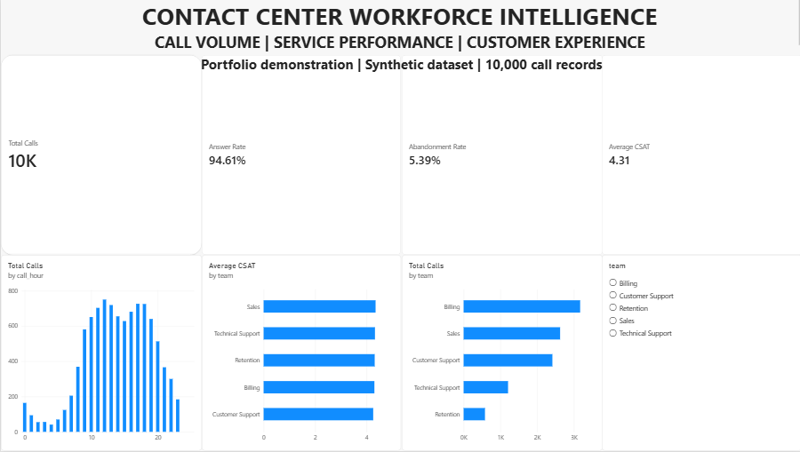

# Contact Center Workforce Intelligence & Analytics Dashboard

An end-to-end data analytics portfolio project that analyzes contact center call volume, agent team performance, customer satisfaction, and service efficiency using Excel, Python, MySQL, and Power BI.

> **Dataset note:** This project uses synthetic data for demonstration and portfolio purposes. The results do not represent a real company's operations.

## Project Overview

Contact centers need to understand when call demand is highest, how efficiently calls are handled, and how customers rate their experiences. This project demonstrates a data analytics workflow for exploring these questions and presenting the results in an interactive dashboard.

## Objectives

- Analyze total, answered, and abandoned calls.
- Measure answer and abandonment rates.
- Explore call volume by hour and team.
- Compare customer satisfaction (CSAT) and first-contact resolution (FCR) across teams.
- Evaluate waiting time, handling time, and revenue.
- Perform data-quality checks and document the results.
- Build an interactive Power BI dashboard for reporting and exploration.

## Technology Stack

- **Microsoft Excel:** PivotTables, KPI summaries, and charts.
- **Python:** Data-quality validation and data preparation using pandas.
- **MySQL:** Data storage, SQL queries, aggregations, and team-level analysis.
- **Power BI Desktop:** Interactive KPI cards, charts, and team filtering.
- **GitHub:** Version control and project documentation.

## Dataset

The main dataset, `call_records_clean.csv`, contains 10,000 synthetic call records with fields covering call dates and times, teams, channels, statuses, waiting time, handling time, resolution, survey responses, customer satisfaction, sales conversion, and revenue.

Additional files include agent roster information and hourly workforce data.

## Key Findings

The SQL and Power BI analyses produced the following overall results:

| KPI | Result |
|---|---:|
| Total calls | 10,000 |
| Answered calls | 9,461 |
| Abandoned calls | 539 |
| Answer rate | 94.61% |
| Abandonment rate | 5.39% |
| Average CSAT | 4.31 / 5 |
| Average wait time | 95.40 seconds |
| Average handling time | 362.55 seconds |
| Total revenue | ₹5,948,166 |

**Metric definitions:**
- Answer rate = Answered calls / Total calls.
- Abandonment rate = Abandoned calls / Total calls.
- Average CSAT is calculated from records with a recorded customer satisfaction score.
- Average handling time excludes zero handling-time records, which correspond to abandoned calls in this dataset.

These findings are illustrative and should not be interpreted as real-world operational benchmarks.

## Power BI Dashboard

The dashboard includes:

- KPI cards for total calls, answer rate, abandonment rate, and average CSAT.
- Hourly call-volume visualization.
- Average CSAT comparison by team.
- Total call volume by team.
- An interactive team slicer to filter the visuals.

The report file is `Contact_Center_Workforce_Dashboard.pbix`.
### Dashboard Preview



## Data Quality

The Python validation workflow checks for duplicate records, duplicate call IDs, missing customer satisfaction scores, invalid values, and consistency between survey responses and CSAT availability.

The cleaned dataset contains 10,000 records with no duplicate call IDs. A total of 5,439 records have no CSAT score because no survey response was recorded for those calls.

Relevant files:
- `data_quality_check.py`
- `data_quality_report.txt`

## SQL Analysis

The SQL script, `contact_center_analysis.sql`, contains queries for:
- Overall operational KPIs.
- Call volume and performance by team.
- Hourly call volume, waiting time, and abandonment.
- Customer satisfaction, first-contact resolution, and survey response rates.

## Repository Contents

| File | Description |
|---|---|
| `Contact_Center_Workforce_Dashboard.pbix` | Power BI dashboard |
| `contact_center_analysis.sql` | SQL analytics queries |
| `data_quality_check.py` | Python data-quality checks |
| `data_quality_report.txt` | Data validation report |
| `call_records_clean.csv` | Main synthetic call dataset |
| `agent_roster.csv` | Agent roster dataset |
| `hourly_workforce.csv` | Hourly workforce dataset |

## How to Explore the Project

1. Review `data_quality_report.txt` to understand the validation results.
2. Read `data_quality_check.py` to explore the Python checks.
3. Open `contact_center_analysis.sql` to review the analytical SQL queries.
4. Open `Contact_Center_Workforce_Dashboard.pbix` in Power BI Desktop to explore the dashboard.
5. Use the CSV files to inspect the synthetic source data.

To run the Python validation script, install pandas if needed and execute:

```bash
python data_quality_check.py
```

The CSV files can be imported into a local MySQL database to reproduce the SQL analysis. Power BI Desktop and an appropriate MySQL connector are required to work with the report and database connection.

## Skills Demonstrated

Data cleaning, data validation, exploratory data analysis, KPI development, SQL aggregation, customer experience analytics, operational reporting, dashboard design, and data storytelling.

## Future Improvements

- Add workforce staffing and capacity analysis.
- Develop more advanced DAX measures and date-based comparisons.
- Improve dashboard styling and accessibility.
- Add automated data refresh and reporting workflows.

---

**Author:** Karandeep Singh  
**Project type:** Data Analytics Portfolio Project  
**Data:** Synthetic / Simulated
